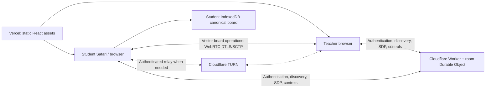

# WhitePad WebRTC migration

## Runtime design

Vite builds a static React application for a **separate Vercel project**. One Cloudflare Worker routes each room ID to a SQLite-backed Durable Object. That object owns room membership, token hashes, current question, lock state, control revisions and teacher-clear generations. Hibernatable WebSockets carry discovery and bounded SDP exchanges. Each student has one reliable, ordered WebRTC data channel to their teacher. A teacher has at most 28 peers; there are no student-to-student subscriptions or connections.

Pointer events draw immediately on the student canvas. Encoding, batching, local recovery and peer delivery happen separately. Drawing contents never enter the Worker, a Vercel Function or cloud storage. Teacher commands use the durable control plane so a disconnected student cannot miss a clear or lock permanently. Confidence and answered status travel over the data channel with board operations.

WebRTC is now the only web transport. The C#/SignalR server, fallback dependency and .NET/Docker release paths are retired in source. The native Swift client uses libwebrtc and the same bundled protocol reducer through JavaScriptCore. This source change does not shut down existing hosted services; old installed iPad app builds require updating. See ipad-transition.md for native integration and rollback limits.

## Hosting decision, checked 20 October 2026

Vercel now supports WebSockets. Its documentation says connections end at the Function's duration limit, and reconnecting clients may reach another instance or deployment. Shared rooms still require external coordination/storage. See [Vercel WebSockets](https://vercel.com/docs/functions/websockets/) and [limits](https://vercel.com/docs/limits/).

A room Durable Object combines coordination and persistent metadata in one service. Its WebSocket hibernation API retains sockets while the object sleeps; attachments restore socket identity after memory is discarded. Room metadata is read from storage rather than assumed to exist in a process. See [Cloudflare WebSockets](https://developers.cloudflare.com/durable-objects/best-practices/websockets/). The platform's documented soft throughput limit is 1,000 requests/second/object, considerably above this design's signalling workload; that is a platform limit, **not a measured WhitePad capacity claim**. See [Durable Object limits](https://developers.cloudflare.com/durable-objects/platform/limits/).

Cloudflare TURN is the only other required runtime integration. The Worker obtains expiring credentials from its authenticated API, caches them per member, and never returns the permanent API token. See [TURN credential API](https://developers.cloudflare.com/realtime/turn/generate-credentials/).

## Credentials and boundaries

| Credential | Issuer and scope | Client location |
|---|---|---|
| Creation access code | School administrator; room creation only | Entered by teacher, not saved or embedded in build |
| Teacher token | Random capability for one room | Teacher tab's sessionStorage; never in join links |
| Join token | Random capability to enrol in one room | Student QR/link; cannot open teacher or session endpoints |
| Student session token | Random capability for one enrolled student | Student localStorage; resumes that student's IndexedDB board |
| WebSocket ticket | One identity, one use, 30 seconds | WebSocket subprotocol, never URL query |
| TURN credential | Authenticated membership, two-hour expiry | RTCPeerConnection configuration |

The server stores SHA-256 hashes of random capability tokens. Each room is isolated by Durable Object identity. Students can signal only `teacher`; teachers can signal only current members of their own room. Server-derived sender identity overrides all client-provided identity claims. The teacher's offer and student's answer share a server-recorded attempt ID. Only the teacher creates offers, avoiding negotiation glare. SDP/ICE stays in transient signalling messages; only the attempt ID is persisted.

Allowed browser origins are explicit. CORS is an additional browser boundary, not the authentication mechanism; non-browser callers can set an Origin header and still need valid credentials. One active socket per member prevents concurrent identity reuse. Kicking invalidates further session, ticket and TURN requests and closes current peers. Already issued TURN credentials can remain usable until expiry; a TURN credential alone cannot subscribe to a WhitePad room.

This is capability authentication with a staff creation code, not school SSO or individual teacher accounts. Protect that code and rotate it when staff access changes. Room capabilities expire with the room after 24 hours.

## Recovery and retention

Students keep vector operations and local board metadata in IndexedDB. The local operation journal appends new operations and small head records. Writes are coalesced, with immediate scheduling at stroke end; a sudden process/device failure can lose work still awaiting the browser's storage transaction. Storage denial/private-mode eviction is shown in connection status. Local storage is not a cloud backup.

The teacher keeps a replica per student. Reconnecting peers compare sequence heads and replay a contiguous missing suffix, capped at 512 operations per replay. Larger or unavailable suffixes use bounded, chunked vector snapshots. Teacher refresh retains its room capability in the tab and asks connected students to recover their boards. Student refresh resumes the same session and hydrates drawing, shapes, background and undo state from IndexedDB.

Teacher-clear generation and control revision are reconciled from the server before replay. On a changed teacher control revision, the compliant student discards unacknowledged offline edits back to its last teacher-acknowledged sequence. A pending local clear keeps one bounded former-board checkpoint for that rollback; acknowledgement allows that extra copy to be removed. An authoritative clear discards the former generation locally, including delayed peer data. The compliant client pauses input while signalling is known to be disconnected or the teacher has locked it; with a disconnected teacher peer and live signalling it may keep a bounded local board pending recovery. Network failure detection is not instantaneous. iPad sleep/background suspension is treated as a disconnect; foreground/online events trigger liveness and peer checks. Reconnect uses capped exponential backoff with jitter.

Room metadata, cached TURN credentials, attempt IDs and tickets are removed by the 24-hour room alarm. Expired tickets are also removed when a member obtains another ticket. Expired local boards are removed on subsequent local-board access. IndexedDB is origin scoped: moving domains or clearing browser data loses that device's local copy. If both student local data and the teacher replica are lost, the drawing cannot be recovered. There is no durable cloud drawing backup in this migration.

## Resource limits and operational limits

The implementation bounds board operations, total serialized board size, point batches, peer ingress, RTC buffered bytes, application queues, SDP size, room members, room creation and signalling requests. The exact wire limits are in [protocol.md](protocol.md). At the board cap the student must clear to continue; no old handwriting is silently pruned. One unacknowledged local-clear checkpoint can add a second bounded 4 MiB serialized board on the student; teacher replicas and transfers have their own per-board caps. Boundaries prevent unbounded memory but do not guarantee a particular iPad memory footprint. Teacher canvas redraw and copy costs must be measured on the intended teacher hardware.

A browser lock governs the legitimate client's classroom experience. It cannot stop a malicious user drawing on their own device, modifying their own local board or writing a custom client. Peer identity isolation and teacher-command authority remain server enforced. This is not a tamper-proof examination/audit system.

Before school rollout, complete authenticated TURN tests, Safari/iPad and Pencil device tests, full lesson-duration load tests and school Wi-Fi/firewall tests. Local Chromium tests are reported separately in [verification.md](verification.md).
